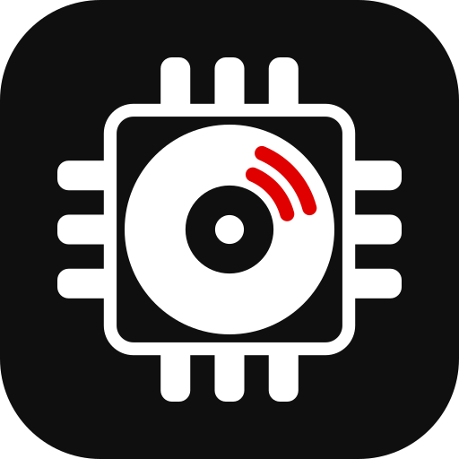

<p align="center">
  
</p>

<h1 align="center">Digarr</h1>

[](https://github.com/iuliandita/digarr/actions/workflows/ci.yml)
[](LICENSE)
[](https://bun.sh)
[](https://www.typescriptlang.org)
[](deploy/docker/)
[](https://github.com/iuliandita/digarr/actions/workflows/ci.yml)
[](https://github.com/iuliandita/digarr/releases)

**Self-hosted music discovery for your library.** Digarr finds artists and albums from your listening history or a mood. Review the suggestions, listen to previews, then send what you like to Lidarr, slskd, or a playlist. Bring your own AI provider or local model. Lidarr is optional.

> [!NOTE]
> **v2.1.0 is out.** It adds personal API tokens and an MCP endpoint for scripts and agents, per-user approval policies, ListenBrainz recommended tracks and Weekly Exploration, an option to skip recently played recordings, per-target playlist export results, and a persistent MusicBrainz cache so scans are fast after a restart. Upgrades from v2.0.x run migrations automatically after the pre-migration backup; read the [upgrade notes](CHANGELOG.md#v210---2026-10-23) first. Coming from v1.19.0, follow the [v2.0.x upgrade procedure](docs/OPERATIONS.md#upgrading-from-v1190-to-v200) first.


This dashboard capture predates v1.19.0; see [current behavior and screenshots](docs/SCREENSHOTS.md).

[More screenshots](docs/SCREENSHOTS.md) | [Quick start](#quick-start) | [Configuration](#configuration) | [Documentation](#documentation)

## What you can do

- **Find artists and albums.** Connect a listening source, scan, and review scored suggestions. Release Radar finds new releases; Library Gap-Fill finds missing albums. Use **Get missing albums** on an artist to review and approve missing studio albums together. Mood and artist searches work without a listening history.
- **Review before adding.** Preview, approve, reject, or permanently block suggestions. Individual and bulk album approval monitor and search only the recommended album in Lidarr. Automatic album approval also uses only the recommended release; its monitoring setting applies to artist recommendations.
- **Keep discovery running.** Run or schedule a mode from one Discovery Modes page, review all schedules in Settings > Schedule, or generate playlists from your connected libraries and catalog searches for Spotify and supported media servers. Saved playlists refresh their bound remote playlists; [explicit recovery](docs/OPERATIONS.md#playlists-and-notifications) handles uncertain creation and changed destinations. Audition playlists use pending artists without approving them. You can also export M3U/XSPF files. Media-server exports use music already in that server's library.
- **Share an instance.** Each user has their own queue, connections, and preferences; admins assign targets to each user. Optional [approval policies](docs/AUTHENTICATION.md#approval-policies) let members request additions for admin review, with score-based trust and open-request limits. Local accounts and OIDC/SSO are supported, with 15 languages and light and dark themes.

Digarr calls your connected services. It doesn't include a downloader or a full music player.

AI suggestions and MusicBrainz matches can be wrong, so check the artist and release before approving. Playlist generation reports local results; it doesn't verify remote playback. Media-server exports require an exact artist/title match after case and whitespace normalization. Unmatched tracks are skipped, and omissions are reported in Job History. See [known limitations](docs/OPERATIONS.md#known-limitations).

### Connections at a glance

| Use | Services |
|-----|----------|
| Scan taste-profile sources | ListenBrainz, Last.fm, Spotify, Plex, Jellyfin, Emby, Subsonic, Discogs |
| [Deezer feeds](docs/AUTHENTICATION.md#deezer-app-setup) | Flow, favorites, followed artists, and playlists (own app required) |
| Library sync | Lidarr, Plex, Jellyfin, Emby, Subsonic |
| Approval and acquisition | Lidarr, slskd |
| Playlist export | Spotify, Navidrome, Jellyfin, Emby, Plex |
| Search | Spotify, Deezer, MusicBrainz; Bandcamp and TIDAL (both experimental) |
| [Audio similarity](docs/OPERATIONS.md#audiomuse-ai-audio-similarity) | AudioMuse-AI (optional, experimental; v3.6.4+) |
| AI recommendations | Anthropic, OpenAI, Gemini, Ollama, OpenAI-compatible endpoints |
| Notifications | Webhooks, ntfy, Telegram, Apprise |
| Critic ratings | music-rater (Critically Acclaimed discovery mode and album score adjustment) |

A connection's capabilities differ by service. Release Radar requires ListenBrainz, Spotify, or Last.fm. Spotify Saved Albums and Followed Artists, Deezer Flow, and Subsonic Starred have focused discovery modes.

In **Settings > Connections**, on the ListenBrainz and Last.fm cards, you can opt in separately to ListenBrainz track loves, ListenBrainz playlists from manual generation, and Last.fm track loves. Scheduled playlist regenerations never send to ListenBrainz. Only exact-track approvals from previews or Audition send loves; rejects and artist-only approvals stay local. Last.fm requires an encrypted per-user connection. See [scrobbler setup and privacy](docs/AUTHENTICATION.md#scrobbler-write-back).

Critically Acclaimed can be narrowed by genre and by coverage type. `Only these genres` and `Never these genres` filter on the genre slugs already in your synced corpus (exclude wins when an album matches both); `Only these kinds of coverage` filters on which editorial columns covered an album -- Review, Album of the Year, Record of the Month, and so on. All three option lists come from your own synced corpus, not a hardcoded list and not fetched from music-rater live, so they only ever offer values that actually appear in your data. Things You Might Have Missed, Stuck in the Filter, Yer Metal Is Olde, and Lost in Time carry no numeric rating at all, so any score filter excludes them by definition -- the advanced, default-off `Include unscored recommendations` toggle is the only way to surface them.

### Privacy and credentials

Your database runs on your server. Connected services still receive requests: hosted AI providers receive discovery prompts, metadata services receive lookups, and embedded previews contact their providers. A local AI model keeps AI requests local, but does not make all of Digarr offline.

Set and retain `DIGARR_ENCRYPTION_KEY` before saving service credentials. Without it, sensitive database fields are stored unencrypted. Back up the key separately from the database; losing it means re-entering encrypted credentials. Application exports preserve persistent state; a native consistent database backup is still required for exact schema rollback. Required automatic-backup failures stop migrations. See the [key rotation guide](docs/runbooks/encryption-key-rotation.md) before changing an existing key.

## Quick start

You need Docker and access to an AI provider or local model. Digarr includes an embedded PostgreSQL database (PGlite), so this runs as one container:

```sh
mkdir digarr && cd digarr &&
(set -C; umask 077 && key=$(openssl rand -hex 32) && printf 'DIGARR_ENCRYPTION_KEY=%s\n' "$key" > digarr.env) &&
docker run -d --name digarr --restart unless-stopped -p 127.0.0.1:3000:3000 \
  --env-file ./digarr.env \
  -e ALLOWED_ORIGIN=http://localhost:3000 \
  -e DIGARR_ALLOW_INSECURE_COOKIES=true \
  -v digarr-data:/app/data -v digarr-backups:/app/backups \
  docker.io/iuliandita/digarr:latest
```

This local-only HTTP example needs OpenSSL and saves the key in protected `digarr.env`. Retain that file for container recreation and recovery. The cookie override avoids browser-dependent Secure-cookie handling on localhost. For other devices, configure an [HTTPS public origin](docs/AUTHENTICATION.md#public-origin-and-reverse-proxies); deliberate HTTP exposes session cookies to interception.

Open `http://localhost:3000` and complete setup. Create the first account or sign in before the wizard. Passwords need 12 characters. The first account becomes admin; further local self-registration is closed by default. OIDC can still create accounts, so restrict access at your identity provider.

For unattended first boot, set both `DIGARR_INITIAL_USERNAME` and `DIGARR_INITIAL_PASSWORD` before starting. The configured admin must be created before HTTP opens; partial credentials or a password shorter than 12 characters stop startup. Leave both unset for manual registration. These settings never reset an existing account. Restrict access until you verify the intended admin. See [first-boot access](docs/AUTHENTICATION.md#users-and-targets).

Use `:latest` for the newest release, a minor tag like `:2.1` for patch updates, or a specific patch like `:2.1.0` to pin a release. Only the newest release receives security fixes. See [image channels](deploy/docker/README.md#image-channels).

For Compose, backend selection, and updates, follow the [Docker guide](deploy/docker/README.md). Keep one app instance per database, verify its backend at `/health`, and [back up before upgrading](deploy/docker/README.md#back-up-and-update).

## Your first recommendations

1. Sign in, then choose Lidarr, Emby, or discovery-only in the setup wizard and configure your AI provider, or skip it and rely on the listening sources you connect later. Requested settings, connections, and targets save together; a failed save leaves setup retryable.
2. Open Settings > Connections > Add connection, then search for a listening or library service. Saved connections appear under Your connections; add export targets under Targets when needed.
3. Run a scan from Dashboard or Discover.
4. Preview, approve, or reject suggestions. Adjust genre priorities in **Settings > Recommendations** if needed. Personal saves work for non-admins. Image-source keys and switches live under Settings > Connections > Artist images; server rows are read-only for non-admins. Use Release Radar or Library Gap-Fill for albums. The net-new album toggle defaults to off and persists when saved.

Open Discovery Modes > Run a mode > Presets and imports for CSV, M3U, XSPF, and connected-service imports. File and playlist imports process the listed artists into recommendations through separate subscription runs. Spotify's `Import Liked Songs` does the same for saved tracks. Imports do not become inputs to a normal scan. Spotify playlist imports honor the saved artist cap across pages; see [limits and playlist access](docs/API.md#subscriptions).

A scan can complete with a failed source. Admins can check Job History for partial results; other users can refresh Discover. Services without similar-artist lookup still contribute their supported listening and library data. See the [pipeline guide](docs/ARCHITECTURE.md#pipeline) for the details.

## Configuration

<a id="connecting-plex-listeners"></a><a id="importing-slskd-downloads-into-lidarr"></a><a id="data-hygiene"></a>
Use Customize on the Dashboard to show or hide any card, drag or use the keyboard to reorder cards, and choose small, medium, or large sizes. Layouts follow your account across devices. Empty cards hide by default; enable Show empty cards to keep them visible. Reset to default restores Today's Pick, Your decisions, Listening, Genres, and Subscriptions. Genres, Subscriptions, Discover's pending and decision views, and Settings > Connections have a Show on dashboard switch for their card.

Use Settings for connections, scoring, schedules, preferences, and language. For scripts, create a named, revocable credential in Settings > Account > API tokens with read, write, or admin scope and an optional expiry; [personal token setup](docs/AUTHENTICATION.md#personal-api-tokens) explains the one-time reveal and permissions. [Authentication](docs/AUTHENTICATION.md) covers origins, cookies, SSO, and proxies. [Operations](docs/OPERATIONS.md) covers Plex listeners, slskd imports, Data Hygiene, playlists, notifications, and local AI.

### Service apps

Connections lists saved services, including incomplete setups. Add connection opens a searchable picker grouped by listening history, streaming accounts, media servers, and collections. Missing admin services are also available there. Disconnecting a service returns it to the picker. The admin-only Show experimental integrations switch at the bottom reveals AudioMuse-AI, TIDAL and Bandcamp in settings, search-source choices, and discovery-mode choices. New setups default to off; completed older setups retain their previously enabled Bandcamp search. Hiding a service does not disable stored connections or scheduled jobs.

<a id="connecting-spotify"></a>**Spotify** needs your own OAuth app, a Premium app owner, and up to five allowlisted Development Mode users. Search needs a connected account. Local HTTP uses `127.0.0.1`, with the same `ALLOWED_ORIGIN` and browser address. Follow [Spotify setup](docs/AUTHENTICATION.md#spotify-app-setup) before changing the quick-start origin.

<a id="connecting-tidal"></a>**TIDAL is experimental:** authorization, refresh, and favorite-artist retrieval have not been tested with a live account. Catalog search needs admin-registered credentials; each user connects their own account for Favorite Artists. Follow [TIDAL setup](docs/AUTHENTICATION.md#tidal-app-setup). <a id="tidal-feedback"></a>The [feedback checklist](docs/AUTHENTICATION.md#tidal-feedback) explains what to report safely.

## Backup and restore

Application JSON exports preserve persistent application state and reject unsafe partial restores before writes. Required automatic-backup failures stop migrations. Retain the matching encryption key separately, and use a native consistent database backup for exact schema rollback. Read [backup boundaries and recovery](docs/guides/switching-backends.md#backup-boundaries-and-recovery) before upgrading or restoring, including the explicit native-backup procedure for older schemas. [Operations](docs/OPERATIONS.md#backup--restore) covers application exports and version-specific upgrade notes.

Audition playlists choose one track per pending artist without approving recommendations, and can refresh on demand or on a schedule. They are separate from the Audition preview queue in Discover, which plays short previews in the browser. The Discover queue retains a dismissible summary of unavailable previews, including missing links, empty or failed lookups, browser blocking, and playback failures. Starting a new queue resets that summary; retrying an item replaces its previous outcome. An embed starting is not proof of a successful listen.

Admins can add webhook, ntfy, Telegram, and Apprise channels in Settings > Notifications, with scan-complete and scheduled-digest subscriptions per channel. Private-network destinations are blocked by default; the per-channel LAN option permits private IPv4 destinations for self-hosted services. It does not override your container or Kubernetes network policy.

### Large Lidarr libraries

Lidarr's artist API returns the entire library in a single response with no pagination, so a very large library can take well over a minute to serialize. Digarr allows 120 seconds for that fetch, which covers libraries into the thousands of artists. If library sync still reports a timeout, raise `DIGARR_LIDARR_TIMEOUT_SECONDS` and restart Digarr. The timeout applies only to the full-library fetch; every other Lidarr call keeps a short timeout so an unreachable Lidarr still fails fast.

### Sharing MusicBrainz with Lidarr, beets and other tools

MusicBrainz rate-limits by source IP, not by application, so Digarr's budget is
shared with everything else that queries MusicBrainz from the same network.
Digarr therefore paces itself at a modest fraction of a typical allowance --
360 requests/hour by default, one every ten seconds -- rather than at
MusicBrainz's published 1 request/second ceiling, which on its own is 3,600/hour
and enough to starve an *arr stack sharing the same address.

On top of that fixed ceiling, Digarr reads the `x-ratelimit-limit`,
`x-ratelimit-remaining` and `x-ratelimit-reset` headers MusicBrainz returns on
every response, and yields as the budget drops: full pace above 40% remaining, a
progressively longer pause through the reserve band, and a hold until the window
resets below 10%. If MusicBrainz rate-limits five responses in a row, a circuit
breaker holds all MusicBrainz traffic for ten minutes and the background library
sync and health scan skip their ticks rather than start work that cannot finish.
This is automatic and self-correcting: Digarr takes the slack when the network
is idle and gives way when it is not.

Set `MUSICBRAINZ_MAX_RPH` to change the sustained ceiling. See `.env.example` for
the reserve, floor and circuit-breaker knobs.

### MusicBrainz mirrors

To use your own MusicBrainz mirror, set these environment variables and restart Digarr:

```dotenv
DIGARR_MUSICBRAINZ_URL=http://musicbrainz:5006/ws/2
DIGARR_MUSICBRAINZ_INTERVAL_MS=100
```

Replace `musicbrainz` with your mirror's hostname as reachable from Digarr. No mirror is bundled: containers need access to your existing mirror's network; local development can use `localhost` if the mirror runs on the same host. Use the full web-service base URL, including `/ws/2` (and any reverse-proxy path). This applies to all MusicBrainz lookups across users, discovery, library sync, and playlist imports. It is configured through the environment only. The Compose examples load these variables from their `.env` file; for Kubernetes, add them to the app container's environment.

The default remains `https://musicbrainz.org/ws/2` with one request per second. Your mirror can use a shorter interval, including `0` for no delay; requests still run one at a time. Public MusicBrainz hosts require at least `1000` milliseconds. Invalid URLs or intervals prevent startup. URLs must use HTTP or HTTPS without credentials, query parameters, or fragments. Redirects are refused, so point directly at the final endpoint. There is no automatic fallback to the public service if your mirror fails.

### Local and OpenAI-Compatible AI

For Open WebUI, choose **OpenAI-Compatible** and use a base URL ending in `/api`, such as `http://<open-webui-host>:<port>/api`. Digarr sends requests to Open WebUI's documented `/api/chat/completions` route. Other compatible servers can use their server root or a base ending in `/v1`. If a local model needs longer to load or generate, set `DIGARR_AI_TIMEOUT_SECONDS` to a suitable value, such as `180`, and restart Digarr; the override applies to both connection tests and recommendation requests.

### Connecting Plex listeners

In Settings > Your Connections, enter your Plex server URL and token, test the connection, select the music library and Plex listener, and save. Each Digarr user selects their own listener on the same shared server. Digarr uses that listener's playback history for recent and frequent artists, and Plex similarity metadata for discovery when available. Lidarr and a scrobbling service are optional; existing Charts and other sources can supplement Plex.

A listener selection is required for listening-based discovery. Existing Plex connections continue to sync their libraries, but need this selection before contributing listening history. Changing the server or token clears the selection. Digarr verifies the server identity and rejects history belonging to a different account instead of mixing profiles. A server or token that cannot expose the account list or playback history can still be used for library sync; Plex similarity data depends on the library's metadata agent. History analysis allows at most 5,000 entries (25 pages) per requested period. If that period cannot be read completely within the limit, top-artist analysis reports a failure instead of returning partial totals; choose a shorter period or another listening source.

### Importing slskd downloads into Lidarr

For a linked slskd target, set **Download root as seen by Lidarr** to the completed-downloads folder that Lidarr can read, such as `/downloads`. Mount the same completed files into Lidarr or configure its path mapping. slskd stores each remote directory under its final folder name; multi-disc folders must be complete and unambiguous before import.

Digarr waits for every queued file to succeed, asks Lidarr to identify the files, and refuses rejected, partial, or ambiguous releases. It imports with move semantics and only reports completion after Lidarr's album tracks have files. Releases are limited to 500 files and 20 GiB, with paths no longer than 2,048 characters. Failed work retries after a one-hour cooldown using the same job; older duplicate failures remain as superseded history. Standalone slskd targets do not import into Lidarr.

If Digarr stops after submitting a download or import but before saving its confirmation, the next run may retry it or report a failure even though the external service accepted it. Check slskd transfers and Lidarr before retrying manually.

### Connecting Spotify

Spotify uses your own Spotify app credentials over OAuth. Spotify requires the owner of a Development Mode app to maintain an active Premium subscription, and listeners must be added to the app's allowlist (up to five users). A normal Spotify sign-in or PKCE does not remove these app requirements; Digarr does not provide a shared Spotify app. See [Spotify quota modes](https://developer.spotify.com/documentation/web-api/concepts/quota-modes).

Without a qualifying Spotify app, use Plex, Jellyfin, Emby, Subsonic, Last.fm, or ListenBrainz listening data, or import artists from CSV. These paths do not require a Spotify subscription.

1. Create an app at the [Spotify Developer Dashboard](https://developer.spotify.com/dashboard).
2. In the app's **Redirect URIs**, add the exact callback URL for your Digarr instance:

   ```text
   <your-digarr-url>/api/v1/auth/oauth/spotify/callback
   ```

   Spotify does not accept `localhost` redirect URIs. For local HTTP use `http://127.0.0.1:3000/api/v1/auth/oauth/spotify/callback`, open Digarr at `http://127.0.0.1:3000`, and set `ALLOWED_ORIGIN` to that same origin. For a remote instance, use its public HTTPS URL, such as `https://digarr.example.com/api/v1/auth/oauth/spotify/callback`. See [Spotify redirect URI requirements](https://developer.spotify.com/documentation/web-api/concepts/redirect_uri).
3. In Digarr, open **Settings > Connections > Spotify**, paste your **Client ID** and **Client Secret**, then click **Connect with Spotify**. The connect form shows the exact Redirect URI to register (with a copy button), so you can match it without guessing.

### Connecting TIDAL

> [!WARNING]
> **Experimental and unverified.** Authorization, token refresh, and favorite-artist retrieval have not been tested against a live TIDAL account. We are shipping with that limitation and asking the community for [feedback](#tidal-feedback). The Experimental badges remain until live results establish that these flows work.

TIDAL uses a single app registered by an admin, which every user then authorizes with their own TIDAL account:

1. An admin creates an app in the [TIDAL Developer Portal](https://developer.tidal.com/) and adds the callback URL for your Digarr instance to its **Redirect URIs**:

   ```text
   <your-digarr-url>/api/v1/auth/oauth/tidal/callback
   ```

   Digarr builds this URI from `ALLOWED_ORIGIN`, not from the URL your browser happens to be on. Set `ALLOWED_ORIGIN` first, then register exactly the URI it produces -- a mismatched scheme or a trailing slash makes TIDAL reject the authorization with no useful error. Production requires `ALLOWED_ORIGIN`. Without it, only non-production loopback callback URLs are accepted.

2. The admin pastes the **Client ID** and **Client Secret** into **Settings > Connections > TIDAL** (the same credentials that power experimental TIDAL search).
3. Each user then opens **Settings > Your Connections > TIDAL** and clicks **Connect TIDAL**. The flow is Authorization Code + PKCE and requests the `user.read` and `collection.read` scopes, which grant read-only access to your TIDAL collection.

Once connected, the **TIDAL Favorite Artists** discovery mode seeds recommendations from the artists in your collection. TIDAL's public API exposes no separate followed-artists list, so favorites are the only user-artist signal.

Each user's connection stores a copy of the app credentials it was made with, so **rotating the shared TIDAL client ID or secret breaks every existing connection.** A still-valid access token may continue to work until it expires; refresh can then fail and require reconnection. After rotating credentials, every user must disconnect and reconnect TIDAL once.

### TIDAL feedback

Live TIDAL testing is deferred because we do not have an account available. This is an accepted release limitation, not a successful validation. The original [validation request (#553)](https://github.com/iuliandita/digarr/issues/553) records the decision; please [open a new issue](https://github.com/iuliandita/digarr/issues/new/choose) with your results so failures can be investigated individually.

After [connecting TIDAL](#connecting-tidal), run **Discover > Discovery Modes > TIDAL Favorite Artists**. Try again after the connection's access token expires, without disconnecting first, to exercise refresh. The read-only `GET /api/v1/auth/oauth/tidal/status` endpoint reports `expiresAt`; a connected status alone does not prove refresh or discovery works.

Please include:

- Your Digarr version and, for nightly, the commit SHA from the footer or `GET /health`.
- Whether authorization, a later run after token expiry, and Favorite Artists each succeeded or failed. Say which steps you did not try.
- The Settings error message or relevant Job History error, with private details removed.
- Whether your TIDAL collection contains favorite artists, the artist count shown in Job History if available, and whether the run produced recommendations. Report an empty result or visible error as shown; it does not by itself identify a missing-name payload problem. Do not include actual artist names.

Do not post client secrets, access or refresh tokens, authorization codes, cookies, or full callback URLs. A successful catalog credential probe does not validate the per-user OAuth flow.

## Backup & Restore

Digarr provides application-level backup and restore through the admin UI (Settings > Administration) or API.

**Manual backup:** `POST /api/v1/admin/backup` returns a JSON file with all configuration, users, targets, subscriptions, and recommendation history. Add `?includeCaches=true` to include artist and genre caches. The file is larger, but restores do not need to fetch that data from MusicBrainz again.

**Restore:** `POST /api/v1/admin/restore?confirm=true` accepts backup JSON or a multipart `file` upload. It replaces the included tables in a transaction; it does not merge a backup into existing account data. Back up the destination first. An encryption-key mismatch returns `409` without restoring. Restore with the original key, or explicitly add `&force=true` and re-enter the affected credentials afterward.

**Legacy OIDC data:** Older backups may contain an obsolete `oidcTokens` table. An empty table is ignored; nonempty rows are skipped with a warning and are never restored.

**Auto-backup before migrations:** When Digarr detects pending database migrations on startup, it saves a backup to `DIGARR_BACKUP_DIR` (default: `./backups/`). It keeps the last 14 auto-backups, counted by migration runs rather than days. Copy backups off the server as well; a local volume does not protect against disk loss. Disable this with `DIGARR_AUTO_BACKUP=false`.

**Upgrading to v1.18.0:** Startup migrations add Plex listener identity fields and consolidate duplicate slskd retry jobs, retaining superseded rows and accumulated attempts. Keep a pre-upgrade backup. Existing Plex connections need a listener selection for history; linked slskd targets need a completed-download path visible to Lidarr. See [Plex setup](#connecting-plex-listeners) and [slskd imports](#importing-slskd-downloads-into-lidarr).

**Kubernetes / Helm note:** Auto-backup needs a writable `/app/backups` volume. The bundled Helm chart and raw manifests use `emptyDir` by default, which is lost when the pod is replaced. Enable `backups.persistence.enabled=true` in Helm, or provide persistent storage in custom manifests.

**Downgrading across the OIDC token-storage migration:** Stop Digarr first, and never run an older image against a database that has already received the migration. Before changing the image tag, use the same Compose file set as the installation so the `app` service runs the current image with its mounted `/app/backups` volume. For example, a PGlite installation uses:

```sh
docker compose -f docker-compose.pglite.yml stop app
docker compose -f docker-compose.pglite.yml run --rm --no-deps app \
  bun dist/scripts/prepare-rollback-backup.js \
  '/app/backups/<automatic-pre-migration-v1.json>' \
  '/app/backups/<rollback-compatible-v1.json>'
```

For the external-PostgreSQL installation, use `docker-compose.yml` and include every override file used by that installation. From a source checkout at the same revision, the equivalent command is `bun scripts/prepare-rollback-backup.ts <input> <output>`.

The input must be the automatic pre-migration backup, use backup version 1, and have no existing `data.oidcTokens` key. The output path must not exist. Provision a separate fresh database with the older image so it creates the old schema, then restore the output copy; never point the old image at the migrated database. The helper writes the copy with mode `0600`, adds only an empty `data.oidcTokens` key, refuses an existing output, and never overwrites the source. It cannot recover retired provider tokens.

### Data Hygiene

Admin tools available under Settings > Administration > Data Hygiene:

- **Clear Image Failures:** reset failed image cache entries so Digarr can retry them
- **Rebuild Genre Cache:** regenerate cached genres from artist tags
- **Re-score Recommendations:** recalculate your recommendations with your current weights, preserving saved score evidence and album modifiers. Rows with incompatible evidence or concurrent changes are skipped.
- **Dedupe Repair:** merge duplicate recommendations
- **AI Reasoning Audit:** review and repair stored reasoning; this cannot guarantee that AI claims are correct
- **Purge Sessions:** clean out expired login sessions

Selecting a backup in Settings > Administration opens a replacement confirmation before any upload. An encryption-key mismatch requires a separate **Restore Anyway** confirmation; retain the original key whenever possible.

## Deployment

| Method | Path | Notes |
|--------|------|-------|
| Docker Compose | [`deploy/docker/`](deploy/docker/) | Recommended. Choose single-container PGlite or the bundled PostgreSQL stack. Also on [Docker Hub](https://hub.docker.com/r/iuliandita/digarr). |
| Helm chart | [`deploy/helm/digarr/`](deploy/helm/digarr/) | Kubernetes. Embedded PGlite, bundled PostgreSQL, or your own database. Keep one app replica. |
| Raw k8s manifests | [`deploy/k8s/`](deploy/k8s/) | Reference manifests for advanced setups. |
| Unraid | [`docs/guides/unraid.md`](docs/guides/unraid.md) | In the Community Applications store (search "Digarr"); bundled template ([`deploy/unraid/digarr.xml`](deploy/unraid/digarr.xml)) as manual fallback. Embedded PGlite by default; external PostgreSQL optional. |
| Synology NAS | [`docs/guides/synology.md`](docs/guides/synology.md) | DSM 7.1+ (Docker/Container Manager). SSH or GUI. |
| Docker Desktop | [`docs/guides/docker-desktop.md`](docs/guides/docker-desktop.md) | macOS and Windows (WSL 2 or PowerShell). |

Any PostgreSQL you supply yourself must be version 15 or newer: migrations create `NULLS NOT DISTINCT` unique indexes. The bundled stacks use PostgreSQL 17.

Check [image signatures and SBOM coverage](deploy/docker/README.md#verifying-image-signatures) before running a release.

## Documentation

- [Configuration and operations](docs/OPERATIONS.md)
- [Authentication, SSO, and user management](docs/AUTHENTICATION.md)
- [API reference](docs/API.md), [architecture](docs/ARCHITECTURE.md), and [name normalization](docs/NORMALIZATION.md)
- [Connect an MCP client](docs/MCP.md) for recommendations, approvals, and scans
- [Recommendation quality evaluation](docs/RECOMMENDATION-QUALITY.md)
- [Discovery recipes](docs/guides/discovery-recipes.md) for discovery-only and existing-library setups, seasonal and decade tags, and familiar versus adventurous tuning
- [Switching database backends](docs/guides/switching-backends.md) and [encryption-key rotation](docs/runbooks/encryption-key-rotation.md)
- [Changelog](CHANGELOG.md), [roadmap](docs/ROADMAP.md), and [screenshots](docs/SCREENSHOTS.md)
- [Other self-hosted music projects](docs/COMPARISON.md)

## Contributing

Bug reports, translations, documentation fixes, and code contributions are welcome. See [CONTRIBUTING.md](CONTRIBUTING.md) for development setup and checks. Report security problems through the [private reporting process](SECURITY.md).

Most code and tests are AI-generated, with a human setting direction and reviewing changes.

## License

MIT. See [LICENSE](LICENSE).

Made by [Iulian Dita](https://iuliandita.com). [Other projects](https://iuliandita.com/projects/).
